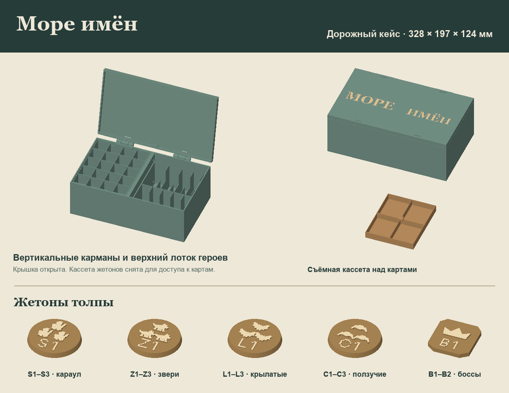

# Дорожный кейс «Море имён»

Размер корпуса в сборе — **328 × 197 × 124 мм**, без выступов петель и крепежа. Основные детали — две цельные ванны, две половины крышки, два лотка фигурок и кассета жетонов. Половины корпуса и крышки соединяются шестью винтами М4. Крышка с гравировкой «МОРЕ ИМЁН» открывается на двух петлях, напечатанных вместе с корпусом. Для каждой петли нужна отдельная металлическая ось.

| Половина с картами | Половина с фигурками |
|---|---|
| Снизу два ряда вертикальных отсеков для всех 458 карточек. У перегородок выемки под пальцы. | Снизу лоток десяти боссов, по одному из каждого королевства. Рядом четыре отсека для жетонов толпы и запасных фишек. |
| Сверху съёмная кассета с четырьмя секциями для ОЗ, искр и щитов, припасов, прочих жетонов и d6. | Сверху съёмный лоток 18 героев. По коду H01–H18 можно найти нужную ячейку. |

Поле лежит в крышке под двумя эластичными лентами. На игровой стол берите полную колоду, 18 героев, 10 объёмных боссов, 12 жетонов толпы и 2 универсальных жетона боссов. Таким набором можно обозначить любое из 300 существ и 100 боссов. Для хранения всех 418 отдельных миниатюр есть большой кейс.

## Печать на K1C

Все детали уже разложены в миллиметрах для поля 220 × 220 мм. Для корпуса, лотков и обеих половин крышки подходят PETG, сопло 0,4 мм, слой 0,20 мм и кайма 3 мм. Сохраните ориентацию и масштаб 100%. Крышка печатается гравировкой к столу. Проверьте первый слой в предпросмотре. Если нужен контраст, после печати заполните гравировку акрилом и вытрите излишки.

1. **Проба.** Напечатайте `00-fit.3mf`. Очистите проушины от опор, вставьте ось Ø4 мм и убедитесь, что петля вращается. Два небольших фрагмента стенки нужны для проверки винта и квадратной гайки на стыке корпуса. Калибр проверяет длинную сторону карты в протекторе до 93 мм. Сами стопки проверьте линейкой по таблице ниже.
2. **Корпус.** По одному запуску `01-cards.3mf` и `02-figures.3mf`. В стенках уже есть отверстия и посадочные карманы. В слайсере проверьте поддержки под внешними проушинами и крупными выступами.
3. **Крышка.** По одному запуску `03-lid-imen.3mf` и `04-lid-more.3mf`. Очистите отверстия для осей, шов и четыре прорези под эластичную ленту.
4. **Лотки.** По одному запуску `05-hero-tray.3mf`, `06-boss-tray.3mf` и `07-token-tray.3mf`. Проложите под каждым лотком фигурок тонкую тканевую ленту и заведите концы через вырезы в противоположных бортах. За оба конца удобно поднять лоток целиком. Миниатюра вынимается за основание, при необходимости подтолкните её через отверстие снизу снятого лотка.
5. **Фишки.** Напечатайте `08-crowds.3mf` одним запуском. Контрастный верхний цвет можно сделать заменой филамента по предпросмотру слоя с рельефом.
6. **Объёмные миниатюры.** Если их ещё нет, напечатайте `09-heroes.3mf` и `10-bosses.3mf` с поддержками по предпросмотру. Эти две пластины используют исходные скульпты серии.

Итого **9 запусков** для кейса, пробы и фишек толпы. Полный дорожный набор с 28 новыми фигурками — **11 запусков**. [Ведомость печати](Ведомость%20печати.csv)

## Крепёж и сборка

| Что подготовить | Количество |
|---|---:|
| Потайной винт М4 × 10 и квадратная гайка М4, 7 × 7 × 3,2 мм | 4 пары |
| Винт М4 × 25 с низкой головкой до Ø7,5 мм и гайка М4 | 2 пары |
| Гладкий штифт Ø4 × 55 мм с фиксаторами на концах | 2 |
| Плоская эластичная лента шириной 12–15 мм | 2 полосы около 230 мм |
| Ремешок с фастексом для закрывания, ширина 15–20 мм | 2 длиной от 740 мм |

1. Совместите ровные торцы половин корпуса. Открытые карманы для квадратных гаек должны смотреть в отсек фигур. Установите гайки до укладки лотков. Вставьте четыре потайных винта из отсека карт. Проверьте, что головки и торцы крепежа не выступают в ряд карт или в ход лотков.
2. Соедините две половины крышки парой винтов. Их проушины должны образовать один ряд с задней стенкой корпуса. Поверните крышку так, чтобы название читалось со стороны закрывания. Поставьте на корпус, совместите проушины и проденьте штифт через три проушины каждой петли. Зафиксируйте штифты с обоих концов.
3. Пропустите концы эластичных лент через пары прорезей в каждой половине крышки. Закрепите с наружной стороны плоскими ограничителями или прошитыми петлями, которые шире прорези. Поле **536 × 360 мм** складывается до **268 × 180 мм**. Допустимый размер вложения с тонким бумажным чехлом — **274 × 182 × 6 мм**. Разместите его по центру крышки под обеими лентами.
4. Уложите лоток боссов вниз, героев сверху. Поставьте кассету жетонов на боковые полки над вертикальными картами. Закройте крышку и застегните два ремешка вокруг корпуса, примерно по центру каждой половины. При переноске поддерживайте кейс снизу. Для мелких жетонов используйте мягкие пакетики по отсекам, чтобы они оставались в своих ячейках при наклоне. При открывании полностью отпустите оба ремешка и подоприте крышку.

## Карты и их отделения

Карты 63 × 88 мм ставятся вертикально на **длинную кромку**. Допустимая внешняя сторона протектора — до 93 × 73 мм. Отделения рассчитаны на толщину карты с протектором около 0,55 мм, но важнее измерить каждую стопку. Если карты плотно прилегают к соседней стопке, положите под пачку тонкую подъёмную ленту и оставьте конец снаружи. Для доступа к картам снимите верхнюю кассету.

| Ряд | Отсеки и допустимая толщина каждой стопки |
|---|---|
| У задней стенки | H01–H18 · 13 мм, I01–I40 · 25 мм, B001–B050 · 29 мм, M001–M060 · 35 мм, M061–M120 · 35 мм |
| У передней стенки | B051–B100 · 31 мм, M121–M165 · 27 мм, M166–M210 · 27 мм, M211–M255 · 27 мм, M256–M300 · 27 мм |

[Реестр кодов фигур и отсеков карт](Фигурки%20и%20карты.csv)

## Как играть с жетонами толпы

| Метки | Рисунок |
|---|---|
| S1–S3 | Караул |
| Z1–Z3 | Звери |
| L1–L3 | Крылатые |
| C1–C3 | Ползучие |
| B1–B2 | Корона, универсальные фишки боссов |

В начале сцены положите карту каждого врага и сопоставьте её со свободной фишкой. Например, жетон **Z1** обозначает гончую M001, а **Z2** — гончую M002. Запишите напротив каждой фишки код карты, текущие ОЗ и зону. Цифра на фишке служит для опознания. Сколько врагов указано в сцене, столько отдельных записей, действий и запасов ОЗ. Статистику и способности берите с карточек.

Если группа находится в одной зоне, можно обозначить её одним жетоном и вести отдельные строки на каждого врага. При разделении поставьте дополнительную фишку в новую зону и перенесите туда строки ушедших врагов. Если подходящие силуэты закончились, назначьте любой свободный жетон или бумажную метку. Для босса без своей фигурки берите B1 или B2. Например, корона B1 на поле может обозначать босса B032 на карте.

## Проверка модели

Габариты исходных 28 миниатюр сверены с ячейками. Проверено, что два лотка и пакет поля помещаются в закрытом корпусе, а смоделированная крышка свободно проходит от 0° до 110° с шагом 5°. Усилие петель, усадку материала и посадку конкретных протекторов нужно проверить на пробной печати.
