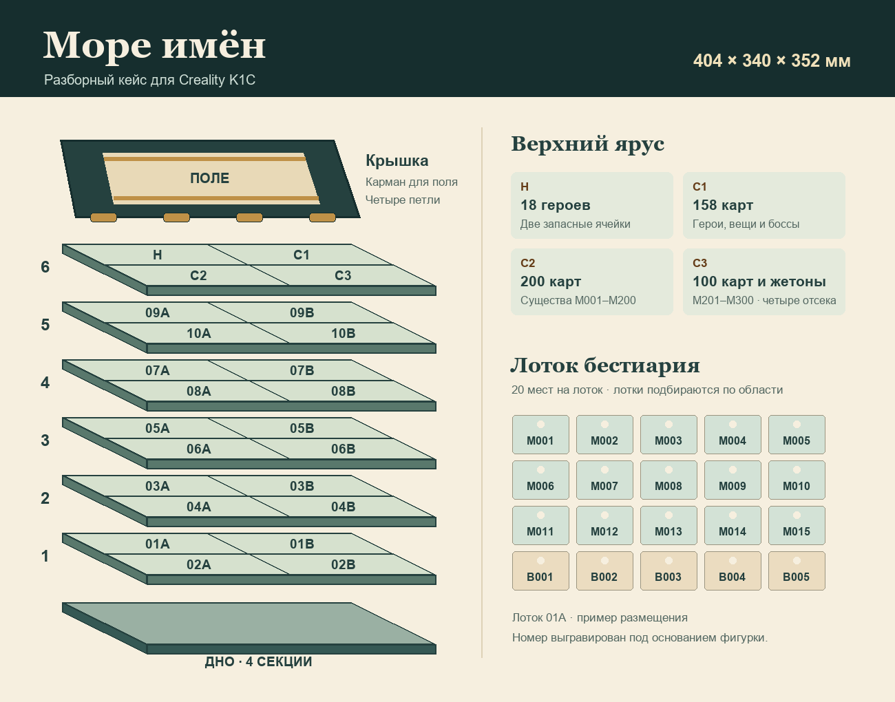

# Кейс «Море имён» для Creality K1C

Корпус в сборе — 404 × 340 × 352 мм. Закладывайте около 420 × 360 × 370 мм для хранения с ножками, наружными креплениями и табличками. Внутри шесть ярусов съёмных лотков. Крышка на четырёх петлях с металлическими осями, спереди две винтовые скобы.

## До печати

1. Откройте `00-fit.3mf` в Creality Print с профилем K1C и соплом 0,4 мм. Оставьте масштаб 100% и позиции из файла. В пробе две половины петли и калибр ширины карты. Вставьте гладкую ось Ø4 мм, проверьте свободный ход и приложите самую широкую карту в протекторе к калибру 93 мм.
2. Напечатайте `40-heroes.3mf` и один из лотков с боссами. Проверьте самую высокую и самую широкую фигурки по указателю, вытолкните их за основание и проверьте установку второго лотка сверху. Для карт напечатайте `41-cards-c1.3mf` и примерьте самую толстую пачку из 50 карт вместе с протекторами.
3. Для корпуса, скоб и петель подходит PETG. Начальные параметры нарезки — слой 0,20 мм, сопло 0,4 мм, кайма 3 мм. Детали разложены в ориентации для печати. Проверьте поддержки от стола на предпросмотре, особенно под горизонтальными отверстиями и выступами скоб. Уберите поддержку из отверстий перед установкой винтов.
4. Самая крупная деталь на пластине занимает 202 × 170 мм. В [ведомости печати](Ведомость%20печати.csv) указано, сколько раз запускать каждый файл. Всего 47 файлов и 80 запусков с пробой. Если напечатали лоток во время проверки, отметьте его как готовый.

## Крепёж и сборка

| Соединение | На собранный кейс |
|---|---|
| Дно со стенками | 16 винтов М4 × 12 с потайными головками |
| Накладки на стыки дна и крышки | 32 винта М4 × 14 с потайными головками |
| Углы, стыки половин стенок и стыки ярусов корпуса | 160 винтов М4 × 14 с потайными головками |
| Петли, крепление к корпусу и крышке | 8 потайных М4 × 14 со стороны корпуса и 8 М4 × 14 с низкой головкой со стороны крышки |
| Оси петель | 4 гладких штифта Ø4 мм длиной около 55 мм с фиксаторами либо подходящие частично резьбовые болты М4 с гладким участком через все три проушины |
| Скобы и винты закрывания | 4 М4 × 14 для неподвижной части, 2 ручных винта М4 × 16 и 2 квадратные гайки М4 с размером грани 7 мм |
| Направляющие и поворотные упоры карты | 8 М4 × 14 и 2 М4 × 12 с низкими головками, 2 самоконтрящиеся гайки для упоров |
| Название и ножки | 4 потайных М4 × 14 для табличек и 4 потайных М4 × 14 для ножек |

К монтажным винтам нужны подходящие гайки М4. В местах крепления снаружи под гайки положите шайбы, если есть запас резьбы. Винты затягивайте вручную до прилегания. Размер отверстий и посадку гаек проверьте на пробе, поскольку усадка и ширина линии зависят от материала и профиля.

1. **Соберите дно.** Сторона петель считается задней. Пластины `10` и `11` образуют задний ряд, `12` и `13` — передний. Бортики смотрят вверх и идут по наружному краю. Соедините четверти четырьмя накладками `33` снизу, центрам накладок соответствуют четыре группы отверстий вдоль двух швов. Головки винтов внутри должны быть заподлицо. Прикрутите ножки `34` и проверьте, что дно устойчиво.
2. **Поднимите стенки.** У всех стенок рёбра обращены внутрь. На каждом поясе поставьте по две половины спереди, сзади и на каждой боковой стенке. Первые два пояса собираются из `20` на длинных сторонах и `21` на коротких. На верхнем поясе сзади поставьте `23` под четыре петли, спереди — `22` под две скобы, по бокам — `21`. В нижнем поясе отверстия на 8 мм от края должны совпасть с бортиками дна. Вставьте винты крепления дна изнутри так, чтобы головки сели в потаи на бортиках. Установите снаружи уголки `30`, вертикальные накладки `31` на стыки половинок и накладки `32` между поясами. Сначала наживите крепёж, проверьте диагонали корпуса, посадку лотков и только затем затяните винты.
3. **Соберите крышку.** Задний ряд — `14` и `15`, передний — `16` и `17`. Соедините четверти накладками `33` с внешней стороны. Прикрутите `38` сверху, «МОРЕ» слева, «ИМЁН» справа. Ориентируйте слова к читающему со стороны замков. Для двухцветного рельефа можно сменить цвет на первом слое букв по предпросмотру. Внутри под картой головки винтов должны быть заподлицо.
4. **Соедините крышку с корпусом.** В каждой петле `35` половина с двумя проушинами крепится к задней стенке, половина с одной — к крышке. Закрепите крышку в закрытом положении, совместите проушины и вставьте четыре оси. Проверьте открывание с опорой под крышкой. Для использования ставьте кейс на стол и поддерживайте открытую крышку устойчивой опорой. При переносе придерживайте кейс снизу.
5. **Установите закрывание.** Скобы `36` крепятся к крышке сверху и охватывают передний край корпуса. Вставьте по квадратной гайке во внутренние карманы панели `22`. В закрытом положении ручные винты проходят через скобы в эти гайки. Перед подъёмом крышки вывинтите оба ручных винта до выхода из стенки.
6. **Закрепите карман поля.** По две направляющие `37` крепятся с внутренней стороны крышки, короткие полки смотрят друг на друга. Поставьте два поворотных упора `36` у боковых входов, оставьте им свободный ход и поверните внутрь для фиксации поля. Карман принимает плоский пакет до 308 × 226 × 8 мм. Поле 536 × 360 мм сложите вчетверо до 268 × 180 мм и вложите в продольный конверт А4, чтобы края удерживались полками направляющих. Примерьте конверт и проверьте оба упора, открывая крышку над столом.

## Раскладка внутри

Первый ряд лотка находится у петель. Ориентируйте лоток так, чтобы гравировка читалась со стороны петель. Для номера ячейки в ряду считайте слева направо по гравировке. Поставьте в ячейку фигурку с тем же кодом, что выгравирован на её дне. Для подъёма самих лотков проденьте тонкие ленты в прямоугольные прорези напротив друг друга. Снимите лоток, чтобы вытолкнуть миниатюру через отверстие снизу инструментом `34`, придерживая её за основание.

| Ярус от дна | Сзади слева | Сзади справа | Спереди слева | Спереди справа |
|---|---|---|---|---|
| 1 | 01A | 01B | 02A | 02B |
| 2 | 03A | 03B | 04A | 04B |
| 3 | 05A | 05B | 06A | 06B |
| 4 | 07A | 07B | 08A | 08B |
| 5 | 09A | 09B | 10A | 10B |
| 6 | H · герои | C1 · герои, вещи и боссы | C2 · существа | C3 · существа и жетоны |

В каждом лотке бестиария 15 ячеек существ и 5 ячеек боссов. В лотке H 18 подписанных мест и 2 запасных. [Реестр 418 фигурок](Ячейки%20фигурок.csv)

| Лоток | Сзади, слева направо | Спереди, слева направо |
|---|---|---|
| C1 · `41` | H01–H18 и I01–I40 | B001–B050 и B051–B100 |
| C2 · `42` | M001–M050 и M051–M100 | M101–M150 и M151–M200 |
| C3 · `43` | HP — ОЗ, SP — искры и щиты, RP — припасы, D6 — прочие жетоны и кости | M201–M250 и M251–M300 |

Номинал карточек — 63 × 88 мм. Максимум для одной пачки с протекторами — 93 × 73 мм в плане и 47 мм по высоте. Гравировка на дне показывает название колоды. Для извлечения пачки снимите лоток и подтолкните её через отверстие снизу.

Положите четыре крышки `39` гладкой стороной вверх на лотки верхнего яруса. Приклейте к каждой плоский язычок из тканевой ленты для подъёма. При перевозке держите кейс горизонтально с обоими ручными винтами. Если лотки поднимаются и крышки подпрыгивают, положите сверху тонкий съёмный слой пены, который слегка поджимает их, и проверьте ход крышки с картой на месте. Сначала проведите такую проверку на пустых лотках.

## Что проверено

Реестр сопоставляет все 418 кодов с габаритами фигурок из файлов полной серии. Наименьший суммарный зазор между моделью и стенками ячейки по одной оси — 2,45 мм. Модель петель проверена на пересечение от закрытого положения до 105° с шагом 5°. Все 47 пластин нарезаны в PrusaSlicer 2.9.6 со столом 220 × 220 мм и соплом 0,4 мм. Посадку деталей после печати и прочность под полной нагрузкой предстоит подтвердить на собранном экземпляре.
